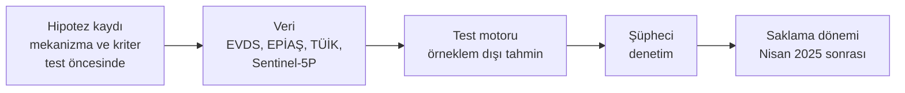
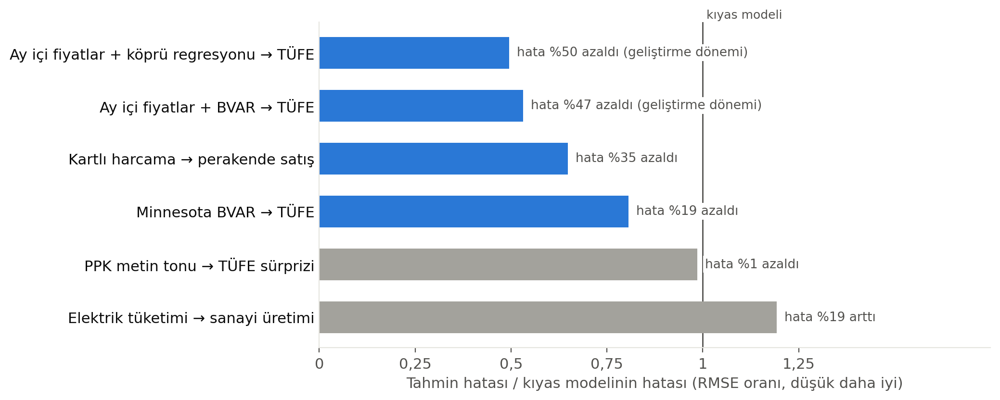

# Türkiye Makro Nowcast Laboratuvarı

## Özet

Bu çalışmada Türkiye'nin enflasyon, sanayi üretimi ve perakende satış verilerini resmi açıklamadan önce tahmin eden (*nowcasting*) bir araştırma sistemi geliştirilmiştir. Sistem elektrik tüketimi, kartlı harcama, uydu ölçümleri, para politikası metinleri ve ay içi fiyat göstergeleri gibi alternatif veri kaynaklarını kullanmaktadır. Yedi hipotez önceden kaydedilerek ortak bir test motoruyla sınanmıştır. Ay içi fiyat göstergelerini kullanan TÜFE modelleri tahmin hatasını yaklaşık yarıya, kartlı harcama modeli ise perakende satış tahmin hatasını %35 azaltmıştır.

## Araştırma düzeni

Sistem, Claude Code üzerinde çalışan dört yapay zekâ ajanından oluşmaktadır. Hipotez ajanı her fikri mekanizması, beklenen öncülük süresi ve başarı kriteriyle birlikte test öncesinde kayda geçirir. Veri ajanı ilgili serileri toplar ve standartlaştırır. Analist ajan testi yalnızca ortak test motoruyla yürütür. Şüpheci ajan ise başarı kriterini geçen her sonucu bağımsız olarak denetler. Hangi sonucun kabul edileceğine araştırmacı karar verir.



Test motoru genişleyen pencereyle örneklem dışı tahmin üretir ve her ay yalnızca o tarihte yayımlanmış olabilecek veriyi kullanır. Her model, hedef serinin kendi gecikmeli değerlerine dayanan otoregresif bir modelle karşılaştırılır. Başarı için üç koşulun birlikte sağlanması gerekir: kök ortalama kare hata (RMSE) oranının 0,90'ın altında olması, yön isabetinin kıyas modelinden yüksek olması ve Diebold-Mariano testinde anlamlılık. Anlamlılık eşiği, projedeki toplam deneme sayısına göre Bonferroni düzeltmesiyle sıkılaştırılır. Nisan 2025 sonrası veri, son doğrulama için saklama dönemi (*holdout*) olarak ayrılmıştır.

## Çalışmalar



### Ay içi fiyat göstergeleriyle TÜFE tahmini (H-006, H-007)

İTO İstanbul fiyat endeksi, akaryakıt fiyatları, Brent petrol ve döviz kuru gibi ay içinde yayımlanan göstergeler, stokastik volatiliteli bir BVAR modeli (H-006) ve bir köprü regresyonu (H-007) ile aylık TÜFE tahminine dahil edilmiştir. İki model de 2019–2025 döneminde kıyas modelinin tahmin hatasını yaklaşık yarıya indirmiştir (RMSE oranı 0,53 ve 0,50). Model tanımları ve test motoru, saklama dönemindeki son doğrulama için SHA-256 ile mühürlenmiştir.

### Kartlı harcama ve perakende satışlar (H-002)

TCMB kartlı harcama verisinin reel değeri, perakende satış hacmini tahmin etmek için kullanılmıştır. Model önceden belirlenen üç başarı kriterinin tamamını karşılamış, tahmin hatasını %35 azaltmış (RMSE oranı 0,65) ve ay ay yön isabetini %57,5'ten %77,5'e yükseltmiştir (Diebold-Mariano p = 0,012).

### Bayesçi VAR ile enflasyon tahmini (H-004)

Sanayi üretimi, döviz kuru, TÜFE ve TCMB ortalama fonlama maliyetini içeren dört değişkenli bir Minnesota BVAR modeli sıfırdan yazılmıştır. Model, 64 aylık örneklem dışı dönemde aylık TÜFE tahmin hatasını %19 azaltmış (RMSE oranı 0,81) ve yön isabetini %61'den %77'ye çıkarmıştır. BVAR yöntemini adım adım anlatan bir ders defteri [`ogrenme/bvar/`](ogrenme/bvar/) klasöründedir.

### Para politikası metinlerinin ton analizi (H-005)

Bu çalışma yaklaşık 100 yapay zekâ ajanının görev aldığı bir iş akışıyla yürütülmüştür. TCMB Para Politikası Kurulu'nun 124 toplantı özetindeki 11.375 cümle, 90 paralel ajan tarafından iki bağımsız geçişte etiketlenmiş ve bir enflasyon tonu göstergesi oluşturulmuştur. İki geçiş arasındaki uyum yüksektir (Cohen kappa ≈ 0,9). Gösterge, TÜFE'nin Piyasa Katılımcıları Anketi'ndeki beklentiden sapmasını tahmin etmek için kullanılmış ve kıyas modeline göre sınırlı bir iyileşme sağlamıştır (RMSE oranı 0,99).

### Elektrik tüketimi ve sanayi üretimi (H-001)

EPİAŞ iş günü elektrik tüketiminin imalat sanayi üretim endeksinin ilk açıklanan değerine öncülük ettiği sınanmıştır. Eğitim döneminde eşzamanlı korelasyon 0,875 bulunmuştur.

### Uydu NO₂ ölçümleri ve sanayi üretimi (H-003)

Sentinel-5P uydusunun Marmara sanayi kuşağındaki NO₂ ölçümleri için veri hattı kurulmuş ve örnek aylarda doğrulanmıştır.

Bunlara ek olarak 83 alternatif veri kaynağını erişim, yayın gecikmesi ve maliyet açısından değerlendiren bir [fizibilite kataloğu](katalog/RAPOR.md) hazırlanmıştır.

## Uygulama

Kod Python ile yazılmıştır (pandas, NumPy, SciPy). Minnesota BVAR ve stokastik volatilite modeli [`src/analiz/bvar.py`](src/analiz/bvar.py), test motoru [`src/analiz/test_et.py`](src/analiz/test_et.py) dosyasındadır.

```bash
pip install -r requirements.txt
cp .env.example .env    # TCMB EVDS ve EPİAŞ erişim bilgileri
python src/veri/anahtar_kontrol.py --baglan
```

Ajan tanımları, test motorunun ayrıntıları, tüm denemeler ve veri kaynakları [`docs/AYRINTILAR.md`](docs/AYRINTILAR.md) dosyasında yer almaktadır. Veri repoda bulunmamaktadır.

## Sınırlılıklar

- **Ay içi fiyat modelleri (H-006, H-007):** Modeller, raporlanan sonuçların ölçüldüğü dönemde geliştirilip seçildiğinden bu sonuçlar henüz bağımsız bir sınama değildir. Nisan 2025 sonrası saklama döneminde sınanmaları beklenmektedir. Şüpheci denetim, önceden yazılan saklama dönemi kriterinin bu örneklem büyüklüğünde çok sıkı olduğunu da göstermiştir.
- **Kartlı harcama (H-002):** Şüpheci denetimde kazancın yaklaşık dörtte üçünün beş kriz ve baz etkisi ayından kaynaklandığı, kasa öncesi son on ayda modelin kıyas modelini geçemediği görülmüş ve hipotez kabul edilmemiştir. Hedef seri 2024'te yeniden kurulmuş revize bir seridir.
- **BVAR (H-004):** Tahmin hatasındaki azalma, Bonferroni düzeltmeli anlamlılık eşiğinde istatistiksel olarak anlamlı değildir (p = 0,067). Kazancın büyük kısmı kriz aylarında oluşmuştur.
- **PPK metin tonu (H-005):** İyileşme anlamlı değildir. Etiketleme sırasında etiketleyiciler belge bağlamını görmüştür, yani etiketler kör değildir.
- **Elektrik tüketimi (H-001):** Örneklem dışında model kıyas modelinden daha yüksek hata üretmiştir; iki seri arasındaki korelasyon 2022 sonrasında işaret değiştirmiştir.
- **Uydu NO₂ (H-003):** Tam serinin işlenmesi tamamlanmadığından hipotez henüz sınanmamıştır.
- **Genel:** Örneklem dışı dönemler 32–68 ay ile sınırlıdır. Saklama dönemi verileri yayımlanmış olduğundan tamamen kör değildir. Hipotez kartları ve analizlerin önemli bir kısmı yapay zekâ ajanlarınca yazılmış, sayılar kayıt dosyalarıyla tutarlılık açısından kontrol edilmiştir.

*Bu çalışma yatırım tavsiyesi niteliği taşımaz. Kod MIT lisansı ile paylaşılmaktadır.*
